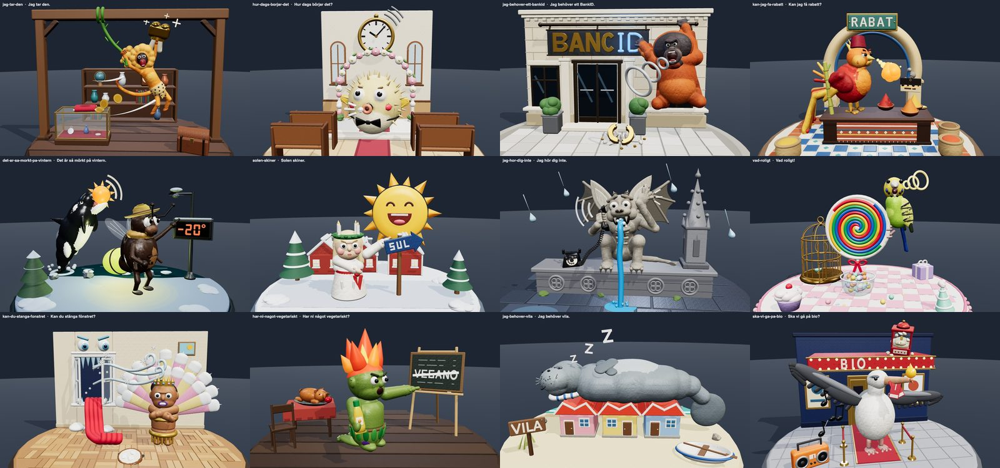
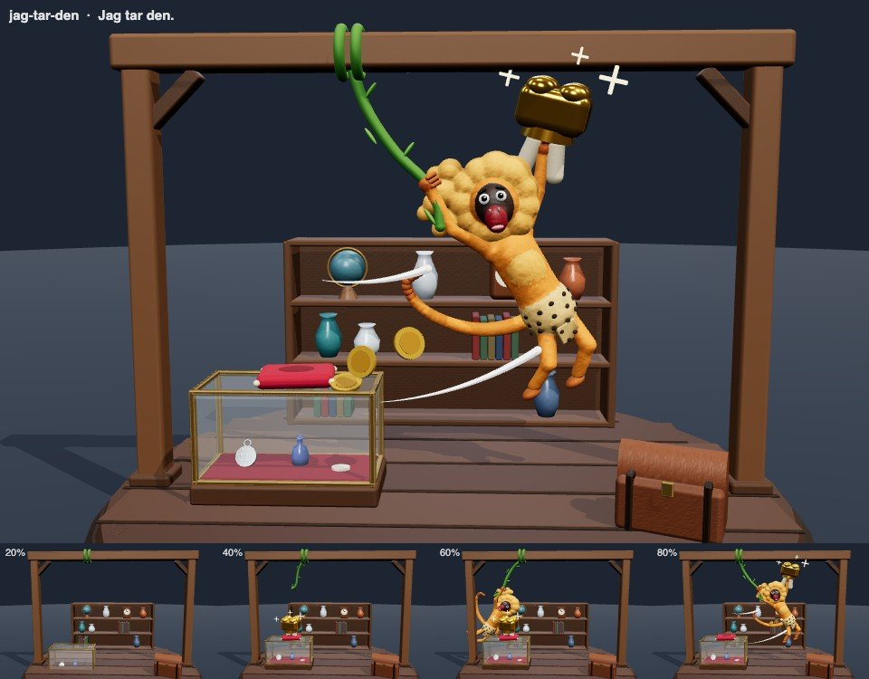
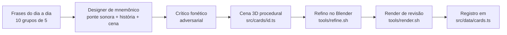

# 🇸🇪 Swedish — flashcards que se montam na sua frente

> **250 frases úteis do dia a dia sueco, cada uma com uma cena 3D absurda que
> se constrói peça por peça diante dos seus olhos — e vai sumindo à medida que
> você aprende.**



Feito para quem fala português e mora na Suécia, mas o sueco ainda não
"grudou". Em vez de decorar a frase seca, cada carta transforma o **som** do
sueco em palavras em português e coloca tudo numa história maluca, em 3D, que
você vê nascer uma única vez. Na revisão, a imagem vai ficando transparente a
cada acerto — até a frase ficar só na sua cabeça.

---

## ✨ Como funciona

```
  PT: "Vou levar."   ─►   ponte sonora em PT   ─►   cena 3D se monta   ─►   SV: "Jag tar den."
                          IÁÁ! TÁR(zan)… DEN(te)!     (uma vez, na sua frente)
```

1. **Construção (uma vez só).** Você vê a frase em português e a cena se monta
   peça por peça: o chão sobe, os personagens entram, cada passo tem uma
   legenda com os sons em MAIÚSCULAS. Dá pra montar tudo de uma vez
   (**▶ Montar tudo**) ou passo a passo (**Próximo passo →**). No fim:
   **Gravei a cena — concluir ✓**.
2. **Revisão.** Aparece a frase em português e a cena congelada. Você tenta
   falar o sueco, clica em **Mostrar resposta** e se avalia:
   - **Acertei** → a cena perde opacidade (nível 4 → 3 → 2 → 1 → 0).
   - **Errei** → a cena volta com tudo (nível 4).
   - Nível 0 = **aprendida**: ela some e só volta pra fila depois de 3 dias.
   - Esqueceu a imagem? **🔨 Reconstruir cena** monta de novo.

O progresso fica salvo no navegador (`localStorage`).

## 🐒 Uma carta por dentro

**Jag tar den.** — *Vou levar.*

| | |
|---|---|
| **Pronúncia** | iá TÁR-den (o *rd* sueco: a língua dobra pra trás e cai direto no D) |
| **Ponte sonora** | **IÁÁ! TÁR**(zan)… **DEN**(te)! |
| **História** | Na loja de antiguidades, um mico-leão-dourado de tanga solta o grito do **TARZAN**, atravessa a loja num cipó e arranca o **DENTE** de ouro da vitrine: *IÁ! TÁR… DEN!* — esse eu levo. |



*Pose final + quatro momentos da montagem (20%, 40%, 60%, 80%).*

## 📚 O baralho

| Lote | Cartas | Temas |
|---|---:|---|
| 1 — piloto | 15 | as frases que validaram o conceito |
| 2 | 15 | consumo, convívio social, ferramentas de aprendizado |
| 3 | 30 | casa, trabalho, saúde, transporte, família, opinião |
| 4 | 40 | cumprimentos, cortesia, conversa, trabalho, pagamentos |
| 5 | 50 | compras, restaurante, transporte, saúde, casa, filhos, sentimentos |
| 6 | 50 | burocracia, telefone, convites, reações, tempo, comida, ajuda, família |
| 7 | 50 | saúde, compras, transporte, social, trabalho, emoções, casa, lazer, comida, Suécia |
| **Total** | **250** | 171 com modelos esculpidos no Blender |

Cada lote distribui um elenco exclusivo de protagonistas, para que nenhuma
cena se confunda com outra — do ornitorrinco à Medusa, passando pelo boitatá,
pelo cavalinho de Dalarna e pela Santa Lucia.

## 🚀 Rodando

```bash
npm install
npm run dev
```

Abra <http://127.0.0.1:5173>. O dev server também fica exposto na rede local
(`host: true`), então dá pra treinar no celular pelo IP do computador — a
câmera se adapta ao celular em pé.

```bash
npm run build     # checagem de tipos + build de produção em dist/
npm run preview   # serve o build
```

## 🧱 Anatomia de uma carta

Cada carta é um arquivo em `src/cards/<id>.ts` que exporta:

```ts
const card: Card = {
  meta: { id, fraseFonte, fraseAlvo, pronuncia, ponteSonora, historia, contexto },
  createScene: () => ({
    root,            // THREE.Group com a cena inteira
    parts,           // peças nomeadas, agrupadas em "passos" de montagem
    build,           // sequências declarativas: { part, at, dur, channels: [{ target, from, to }], caption }
    cameraHint,      // enquadramento de referência (960×600)
  }),
  refine: { organic: ['mico', 'cabeca', 'rabo'] },  // peças que o Blender funde e esculpe
}
```

A cena é **procedural** — primitivas do Three.js combinadas com o kit de
`src/rig/helpers.ts` (`person()`, `rbox`, `lathe`, `puff`, `rock`,
`shoulderPivot`…). As peças têm origem física (sobem do chão, telescopam,
dobram) e a última `to` de cada canal é exatamente a pose final. A arquitetura
de montagem é inspirada em
[mechanical-deployables-treejs](https://github.com/trungdq88/mechanical-deployables-treejs),
sem a estética industrial.

## 🏭 Pipeline de produção



- **Curadoria** (`curadoria/`): cada lote tem as frases, a pronúncia, a ponte
  sonora, a história e a lista de peças da cena. Um crítico adversarial lê
  cada ponte "como um brasileiro que não sabe sueco" e corrige o que sairia
  errado da boca (vogal longa × curta, R do presente, tônica deslocada…).
- **Refino no Blender** (`tools/refine.sh <id>`): exporta o blockout da carta
  via Chrome headless, funde as primitivas das criaturas numa pele contínua
  (voxel remesh), esculpe relevo, faz bake de oclusão e publica
  `public/refined/<id>.glb` com compressão Draco. O app usa o modelo
  refinado quando ele existe e cai na versão procedural quando não.
- **Revisão visual** (`tools/render.sh <id> [raw] [LxA]`): gera
  `blockout/review/<id>.jpg` com a pose final e quatro quadros da montagem —
  com `400x700`, confere o enquadramento de celular.

### Rotas de inspeção (dev)

| Rota | O que faz |
|---|---|
| `?pose=<id>` | pose final de uma carta (`&raw` = sem o refino do Blender) |
| `?contact` | folha de contato com todas as cartas |
| `?render=<id\|a,b\|all>` | gera a folha de revisão |
| `?export=<id\|all>` | exporta o blockout para o pipeline do Blender |

## 🗣️ Convenções das pontes sonoras

| Na ponte | Som sueco |
|---|---|
| **IÁ** | *jag* (nunca J chiado) |
| **RR** | o *h* sueco, soprado como o R carioca |
| **Ü** | boca em bico de U com a língua no I (*du*, *hur*, *dyrt*) |
| **Ô** / **Ó** | *å* longo (*gå*, *få*) / *å* curto (*långt*, *måste*) |
| **…AR** | o R do presente é obrigatório: *har*, *går*, *snöar* |
| **CA-NIÁ**, **VARA**, **DÊ É**, **M'ÊI** | âncoras reaproveitadas: *kan jag*, *var*, *det är*, *mig* |

Palavras que se repetem usam sempre a **mesma** âncora em todas as cartas, e
verbos com partícula levam a força na partícula (*ta MED*, *lämna tillBAka*).

## 🗂️ Estrutura

```
src/
  cards/        250 cartas, uma por arquivo
  data/         registro das cartas (cards.ts)
  rig/          motor: tipos, montagem, câmera, kit de modelagem, refino
  components/   palco, canvas, pós-processamento (N8AO, bloom, vinheta)
  views/        início, construção, revisão
  store/        progresso (zustand + localStorage)
  dev/          rotas de inspeção e render
curadoria/      frases, pronúncias, pontes e histórias de cada lote
tools/          refine.sh, render.sh, headless.sh e scripts do Blender
public/
  refined/      modelos esculpidos (.glb com Draco)
  draco/        decoder Draco
docs/           imagens deste README
```

## 🛠️ Stack

[Vite](https://vite.dev) · [React 19](https://react.dev) ·
[Three.js](https://threejs.org) ·
[@react-three/fiber](https://r3f.docs.pmnd.rs) + drei ·
[postprocessing](https://github.com/pmndrs/postprocessing) + N8AO ·
[zustand](https://zustand.docs.pmnd.rs) ·
[Blender](https://www.blender.org) (headless) para esculpir as criaturas.

Os scripts de `tools/` esperam o Blender em `/Applications/Blender.app`, o
Google Chrome instalado e o dev server rodando em `127.0.0.1:5173`.

---

<p align="center"><i>Lycka till! 🍀 — e que o mico-leão-dourado nunca saia da sua cabeça.</i></p>
